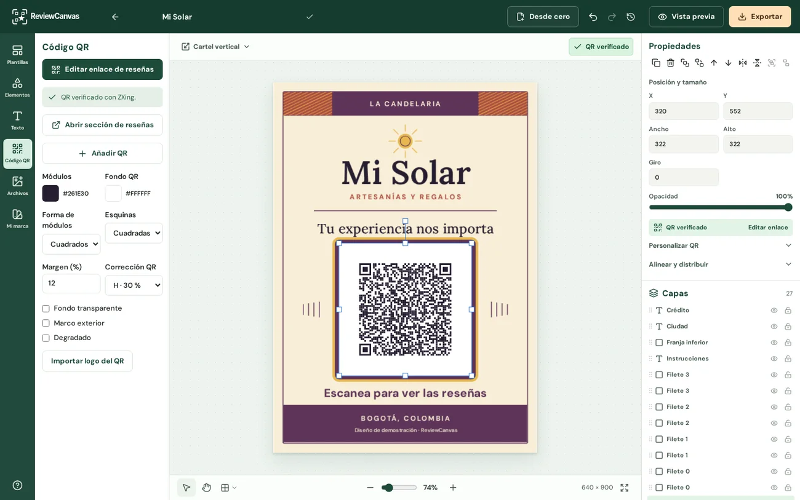

# ReviewCanvas

ReviewCanvas es un estudio web en español para diseñar carteles con códigos QR de Google Maps. Puedes empezar con un lienzo vacío, pegar tu enlace para generar el primer QR o elegir una plantilla y editar sus capas.

## Demostración



Cartel de muestra diseñado para **Mi Solar**, una tienda de artesanías de Bogotá. El QR del PNG a 300 DPI se decodificó con ZXing y el enlace abrió «Todas las opiniones» en Google Maps móvil. La demostración es independiente. [Ubicación publicada por Mi Solar](https://www.misolar.co/tienda-fisica/)

- [Video corto](docs/media/demo-mi-solar.mp4)
- [Cartel con QR de muestra](docs/media/cartel-mi-solar.png)
- [Diseño editable](docs/media/mi-solar.reviewcanvas.json)
- [Abrir reseñas en Google Maps](https://www.google.com/maps/place//data=!4m4!3m3!1s0x8e3f99af5a71ea65:0x3d3d9b6c33081be5!9m1!1b1)

## Lanzamiento gratuito

[Guía detallada de despliegue](docs/DESPLIEGUE.md) para Cloudflare Pages, Render con Docker, Neon y Supabase Storage. El editor invitado guarda los proyectos localmente y permite exportar con la API suspendida.

## Arranque local

Requisitos para el editor: Node.js 22.12 o posterior y npm. La cuenta, la sincronización y los QR dinámicos también requieren PostgreSQL.

```bash
npm ci
npm run dev
```

Abre http://127.0.0.1:5173. El editor invitado, IndexedDB, la comprobación ZXing y las exportaciones funcionan con el frontend.

**Ver reseñas** es el destino predeterminado de los diseños nuevos. Pega el enlace completo de la ficha del negocio. Si la dirección identifica el establecimiento, ReviewCanvas genera el enlace de la sección de reseñas de Maps web. La API local puede expandir enlaces cortos compatibles. Para buscar por Place ID, configura `GOOGLE_PLACES_API_KEY` y habilita Places API (New). [Enlaces documentados por Google](https://developers.google.com/maps/documentation/places/web-service/maps-links)

**Escribir una reseña** acepta el enlace de «Pedir reseñas» de Google Business Profile o un Place ID. [Ayuda oficial de Google](https://support.google.com/business/answer/16816815?hl=es)


### API y base de datos

1. Copia `.env.example` a `.env` y configura `DATABASE_URL` para una base de datos de ReviewCanvas. Usa una contraseña propia y no versionada.
2. Ejecuta `npm run db:generate` y después `npm run db:migrate`.
3. Ejecuta `npm run dev:api` en otro terminal. Vite reenvía `/api` y `/r/` al puerto 4174.

`APP_ORIGIN` debe coincidir exactamente con el origen de la interfaz. `GOOGLE_PLACES_API_KEY` activa la búsqueda opcional. Está pensada como clave de servidor. Usa HTTPS y cookies seguras en una instalación pública.

### Docker Compose

Rellena `POSTGRES_PASSWORD` y configura `DATABASE_URL_DIRECT` con la base Compose en `127.0.0.1:5436`. Arranca la base, aplica las migraciones y después inicia la API. El frontend local se sirve con Vite.

```bash
docker compose up -d db
npm run db:migrate
docker compose up --build app
npm run dev
```

Fastify expone `/healthz` como sonda del proceso y `/api/health` para comprobar la conexión a PostgreSQL.

## Flujo de trabajo

- **Desde cero.** Elige «Ver reseñas» o «Escribir una reseña» y pega el enlace del negocio. El editor coloca un QR centrado y puedes cambiar su diseño. El nombre del negocio es opcional.
- **Desde una plantilla.** Elige uno de los diseños, selecciona capas en el lienzo o el inspector y cambia texto, fuentes, colores o composición. Vincula el negocio para sustituir el QR de muestra por el destino elegido.
- **Validación.** ZXing intenta leer el QR sobre la composición. Las advertencias indican problemas de posición, contraste, espacio libre o cobertura. Verifica la lectura del archivo después de imprimirlo al tamaño elegido.
- **Exportación.** Elige PNG, JPG, SVG, PDF o JSON editable. Desde «Mis proyectos» puedes organizar diseños y descargar los proyectos visibles como un ZIP de JSON.

## Estructura

| Ruta | Función |
| --- | --- |
| `src/model.ts` | Modelo validado de proyecto, capas, marca y configuración del QR |
| `src/editor/` | Fabric.js, interacción, historial, previsualización, verificación y exportación |
| `src/library/` | Composiciones editables del catálogo y decoraciones vectoriales |
| `src/storage.ts` | IndexedDB para diseños, preferencias y versiones |
| `ReviewCanvas-assets/` | Kit original, fotografías de contexto y miniaturas WebP |
| `server/` | API Fastify, autenticación, validación, sincronización y QR dinámicos |
| `prisma/` | Esquema y migración de PostgreSQL |
| `tests/` | Pruebas unitarias, integración con PostgreSQL y navegación |

Los proyectos se serializan con un esquema propio versionado. El modelo guarda datos editables y Fabric.js reconstruye los objetos al abrir el proyecto. PNG y JPG guardan los metadatos de resolución. PDF utiliza las dimensiones físicas correspondientes a la resolución seleccionada. El SVG conserva las formas y el QR como vectores.

## Pruebas

```bash
npm run build
npm test
npx playwright install chromium
npm run test:e2e
```

Para ejecutar las pruebas de integración, aplica la migración en una base de datos de pruebas y usa `TEST_DATABASE_URL=... npm test`. Las pruebas crean y eliminan sus propias cuentas de prueba. Si ya tienes un Chromium compatible puedes establecer `PLAYWRIGHT_CHROMIUM_EXECUTABLE`.

Consulta [IMPLEMENTACION.md](IMPLEMENTACION.md) para ver qué se comprobó y las limitaciones.
